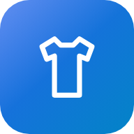
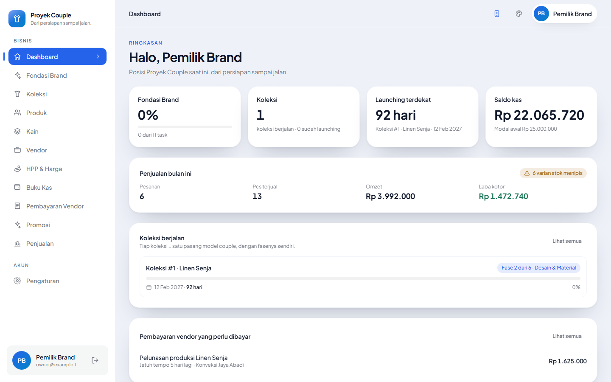
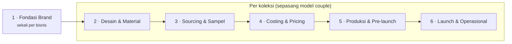
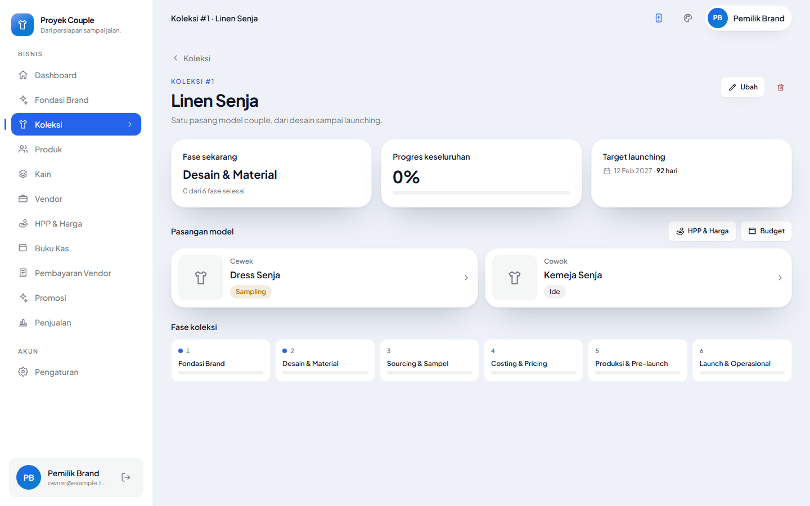
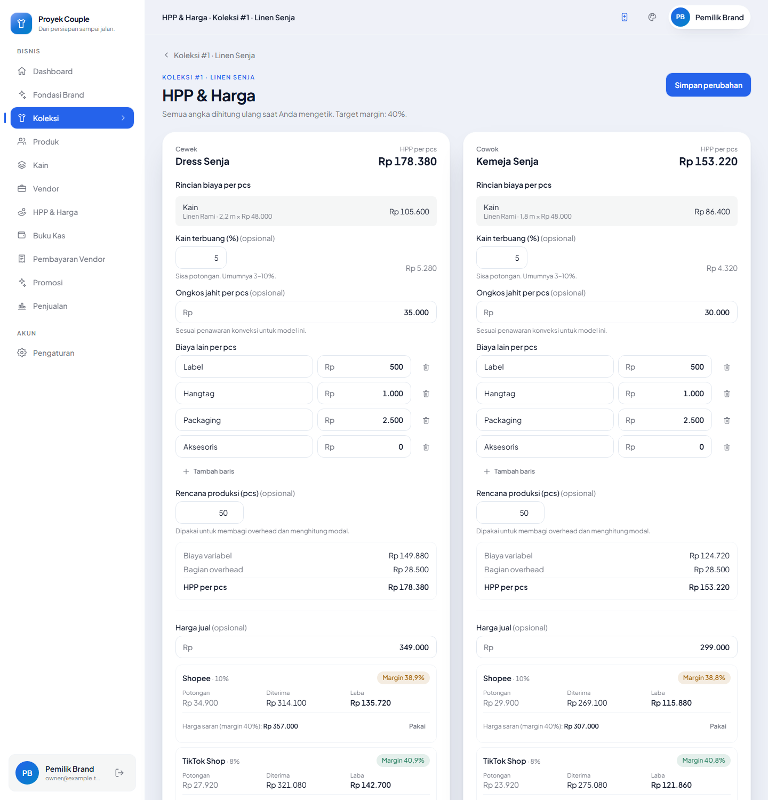
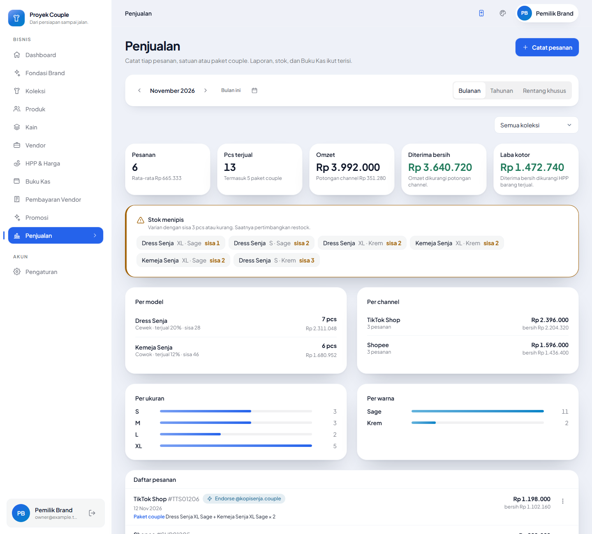
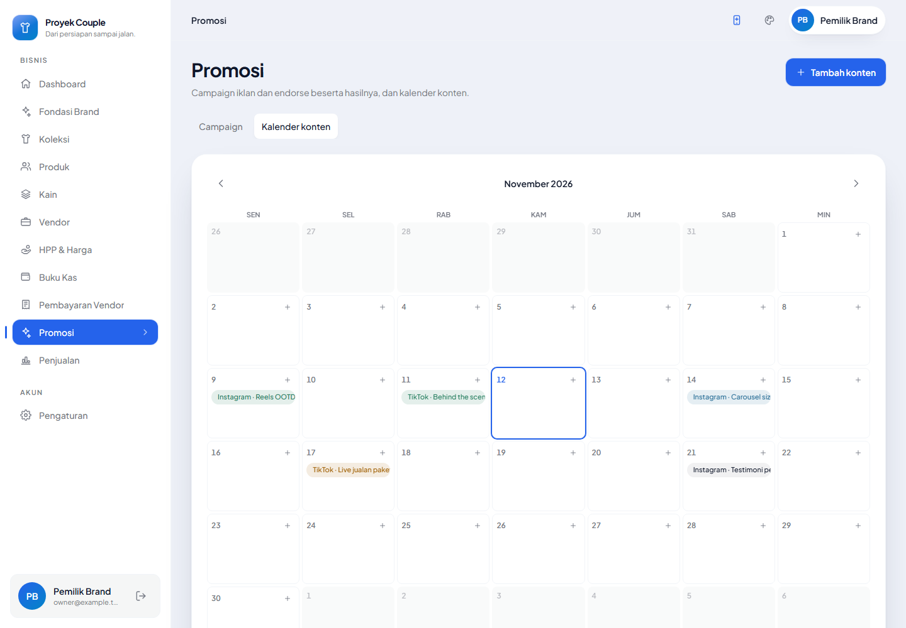
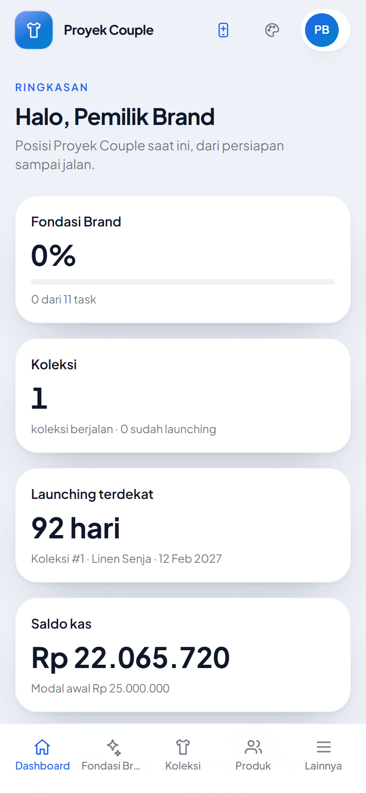
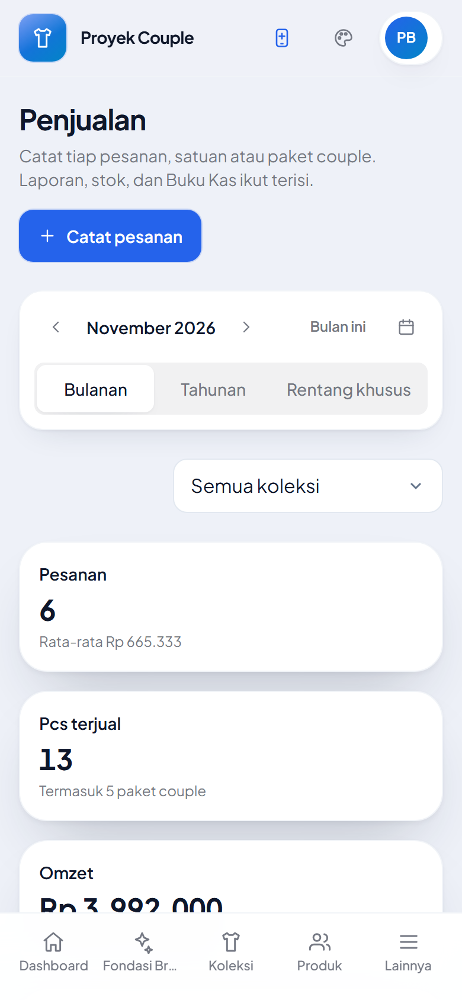

<div align="center">



# Bisnis Fashion

**Monitoring bisnis fashion couple, dari riset brand sampai pesanan pertama.**

[](https://github.com/nimassap/bisnis-fashion/actions/workflows/ci.yml)




</div>

---

## Tentang

Aplikasi web untuk pemilik brand fashion **couple**. Satu **koleksi** adalah satu
kali produksi berisi sepasang model, yaitu model cewek dan model cowok. Aplikasi
memandu tiap koleksi melalui fase-fasenya, menghitung HPP dan harga jual,
mencatat uang masuk dan keluar, lalu memantau penjualan dan promosi setelah
launching.

Saat ini aplikasi dipakai oleh satu pemilik. Semua data menempel ke tabel
`businesses`, bukan langsung ke `users`, supaya anggota tim dengan role bisa
ditambahkan nanti tanpa migrasi besar.



Fase hanya bisa ditutup kalau fase sebelumnya sudah selesai dan semua task
**gate**-nya dicentang. Task di fase berikutnya tetap bisa dikerjakan lebih awal.

## Fitur

| Modul | Isi |
|---|---|
| **Fondasi Brand & Fase** | Checklist bawaan per fase, task gate, tenggat dan tanda telat, catatan keputusan beserta alasannya |
| **Koleksi** | Satu koleksi = satu pasang model couple, nomor otomatis, target launching, langkah fase |
| **Produk** | Tech pack, foto/sketsa, size chart per titik ukur (cewek dan cowok berbeda), riwayat sampel per putaran |
| **Kain & Vendor** | Library kain dengan hasil tes susut/luntur dan foto swatch; perbandingan penawaran konveksi (harga, MOQ, lead time, rating) dan tombol WhatsApp |
| **HPP & Harga** | HPP per pcs (kain + kain terbuang + ongkos jahit + biaya lain + overhead), harga satuan dan **paket couple**, margin per channel, harga saran sesuai target margin, modal, dan titik balik modal |
| **Buku Kas & Budget** | Uang masuk/keluar dengan foto nota, kategori, ekspor CSV/Excel; budget per koleksi per kategori; jadwal pembayaran vendor yang otomatis tercatat saat lunas |
| **Penjualan** | Pencatatan per pesanan (satuan dan paket couple), potongan channel dan HPP disimpan saat transaksi, stok per ukuran × warna, alert restock, laporan per model, channel, ukuran, dan warna |
| **Promosi** | Campaign iklan, endorse, dan affiliate dengan ROAS dari pesanan; kalender konten bulanan |
| **PWA** | Bisa dipasang di layar utama HP, halaman offline, banner saat ada versi baru |

<table>
  <tr>
    <td></td>
    <td></td>
  </tr>
  <tr>
    <td align="center"><sub>Koleksi: pasangan model dan fase</sub></td>
    <td align="center"><sub>HPP, harga per channel, dan paket couple</sub></td>
  </tr>
  <tr>
    <td></td>
    <td></td>
  </tr>
  <tr>
    <td align="center"><sub>Penjualan, stok menipis, dan laporan</sub></td>
    <td align="center"><sub>Kalender konten</sub></td>
  </tr>
</table>

<p align="center">
  
  &nbsp;&nbsp;
  
</p>

## Teknologi

- **Backend:** Laravel 13, PHP 8.4+, MySQL 8 / MariaDB 10.4+
- **Antarmuka:** Livewire 4 + Alpine.js, Tailwind CSS 4, Chart.js
- **Uang:** semua nominal disimpan sebagai `DECIMAL(18,2)` dan dihitung dengan `bcmath`, tanpa float
- **Foto:** disimpan privat di `storage/app/private/businesses/{id}/` dan hanya dikirim ke pemilik bisnisnya
- **Ekspor:** CSV dan Excel (OpenSpout), aman dari formula injection

Sebagian fondasi diambil dari project *monitoring-keuangan*: format uang, rentang
periode, sistem tema, komponen Blade, ekspor, dan PWA.

## Menjalankan secara lokal

**Prasyarat:** PHP 8.4+ dengan ekstensi `intl`, `bcmath`, `pdo_mysql`, `zip`;
Composer; Node.js 20.19+ atau 22.12+; MySQL 8 atau MariaDB.

```bash
git clone https://github.com/nimassap/bisnis-fashion.git
cd bisnis-fashion

composer install
npm install

cp .env.example .env
php artisan key:generate
```

Buat dua database, satu untuk aplikasi dan satu untuk tes:

```sql
CREATE DATABASE bisnis_fashion CHARACTER SET utf8mb4 COLLATE utf8mb4_unicode_ci;
CREATE DATABASE bisnis_fashion_test CHARACTER SET utf8mb4 COLLATE utf8mb4_unicode_ci;
```

Sesuaikan `DB_*` di `.env`, lalu:

```bash
php artisan migrate --seed
npm run build
php artisan serve
```

Buka http://127.0.0.1:8000 lalu masuk dengan akun contoh:

| Email | Kata sandi |
|---|---|
| `owner@example.test` | `password` |

Data contoh berisi satu koleksi lengkap: sepasang model, kain, vendor, harga,
catatan kas, pesanan, campaign, dan konten.

Untuk database kosong tanpa data contoh, jalankan `php artisan migrate` saja.
Aplikasi akan membuka halaman **setup** untuk membuat akun pemilik. Halaman itu
tertutup permanen setelah akun pertama dibuat.

> **PWA di HP** hanya aktif lewat HTTPS atau `localhost`. Membuka server lokal
> lewat IP Wi-Fi (`http://192.168.x.x`) menampilkan aplikasinya, tapi tidak
> menampilkan tombol pasang dan tidak mengaktifkan mode offline.

## Tes

```bash
php artisan test            # seluruh tes, memakai database bisnis_fashion_test
./vendor/bin/pint --test    # cek format kode
```

Tes memakai MySQL sungguhan, bukan SQLite, karena kolom nominal bertipe
`DECIMAL` dan beberapa laporan memakai fungsi tanggal. GitHub Actions menjalankan
tes, build aset, cek format, dan audit dependensi di setiap push.

## Struktur

```
app/
  Actions/       Operasi sekali jalan (seed fase, tutup fase, bayar vendor)
  Enums/         Status dan jenis: produk, vendor, kain, pesanan, campaign, …
  Livewire/      Halaman per modul
  Models/        Model Eloquent
  Services/      Perhitungan lintas model: PhaseBoard, laporan penjualan, stok, budget
  Support/       Money, DateRange, MediaStore, kalkulator HPP (Pricing/Calculator)
config/          phases, pricing, cashbook, sales, products, theme
lang/id/         Seluruh teks antarmuka
resources/views/ Komponen Blade dan template halaman
tests/           Tes fitur dan unit
docs/            Screenshot README
```

## Kontribusi

- Kerjakan di branch terpisah, lalu buka pull request ke `main`.
- Pesan commit mengikuti [Conventional Commits](https://www.conventionalcommits.org):
  `<tipe>(<modul>): <ringkasan>`, misalnya `feat(penjualan): catat pesanan paket couple`.
  Template lengkapnya ada di [`.gitmessage`](.gitmessage); aktifkan dengan
  `git config commit.template .gitmessage`.
- Laporan bug dan usulan fitur memakai template di tab **Issues**.

## Rencana berikutnya

- Role tim: desainer, admin, marketing
- Pengingat jatuh tempo lewat email atau notifikasi HP
- Import pesanan dari file ekspor Shopee dan TikTok Shop
- Scan nota pakai AI
